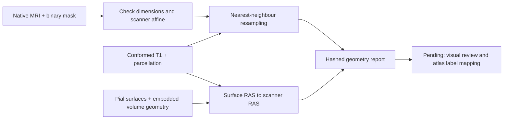

# First IDEAS anatomy case

The first acquired case is `sub-14`, an eligible subject in the local first-year cohort. Only its FreeSurfer reconstruction and the small resection-mask collection were downloaded; the 104.56 GB reconstruction collection is unnecessary for this initial integration.

| Asset | Figshare file | Bytes | SHA-256 |
| --- | --- | ---: | --- |
| `14.tar.gz` | 45685407 | 216008983 | `39481f03d3a4991fb0c86ed8907f427d07ecb847c2aa547c65cebd004fedbcc6` |
| `masks.zip` | 59730383 | 3492594 | `569447c0dd59ada455b23dded84486ff352835240a48d624ebc205c1847aefc3` |

These hashes were calculated after HTTPS acquisition, not supplied independently by the publisher. Source collection links are recorded in [ideas-sources.json](../configs/datasets/ideas-sources.json). Download receipts and patient files remain in ignored `data/ideas/anatomy/`; no patient images are packaged with the application.

## Reproduce the geometry audit

Install the anatomy extra with the repository constraints:

```sh
.venv/bin/pip install -c requirements.lock -e './packages/neurocore[anatomy]'
```

Prepare `data/ideas/anatomy/sub-14/` with these regular files from `14.tar.gz`, removing the leading `14/` directory:

- `mri/rawavg.mgz`: native reference
- `mri/T1.mgz`: conformed reference
- `mri/myaparc_36.mgz`: supplied parcellation
- `surf/lh.pial` and `surf/rh.pial`: hemisphere surfaces

Copy the ZIP member `masks/sub-14/ses-1/sub-14_ses-1_space-native_resection.nii.gz` to `resection.nii.gz` in that directory. Extract only the named regular members; do not execute archive scripts or follow archive links. Then run:

```sh
.venv/bin/python -m neurocore.anatomy data/ideas/anatomy/sub-14 \
  --subject-id sub-14 --output data/ideas/anatomy/sub-14-audit.json
```

The output must be a new file. The report hashes each input and records transforms, dimensions, mask volume and surface bounds. Subject identity is supplied by the caller and must be checked against archive/cohort provenance; it is not inferred from image intensities.



The conversion uses `reference.affine @ inverse(reference.header.get_vox2ras_tkr())`; surface embedded volume dimensions, directions, voxel sizes and center must match that reference first. This follows the coordinate distinction exposed by [NiBabel's FreeSurfer interface](https://nipy.org/nibabel/reference/nibabel.freesurfer.html). Mask resampling uses [NiBabel's resample_from_to](https://nipy.org/nibabel/reference/nibabel.processing.html#nibabel.processing.resample_from_to) with nearest-neighbour interpolation. It uses the supplied scanner coordinates and does not estimate a new registration.

## Observed checks and remaining gates

The native mask and MRI both have shape 256 × 170 × 256 and matching scanner affines within 0.0001 mm elementwise tolerance. The conformed MRI and parcellation share a 256³ grid. Both surface headers match the conformed reference. The left/right pial meshes contain 138,079/136,624 vertices and 276,154/273,244 triangles.

The binary mask contains 53,663 native voxels, approximately 51,881 mm³. Nearest-neighbour resampling gives 51,494 conformed voxels, a −0.746% volume change; 84.22% of those voxels fall within nonzero parcellation labels. These measurements are quality-control observations, not proof of correct anatomical registration or a tissue-specific resection estimate.

The audit deliberately leaves three gates unresolved: visual alignment review, correspondence between image labels and the 82-region connectome order, and confirmation of the published regional-resection units. The existing UI still uses explicitly synthetic geometry. This acquisition/audit does not enable real-patient prediction or physical resection editing.

The subsequent [regional mapping audit](ANATOMICAL_REGIONS.md) resolves numeric label/name correspondence and records the remaining fraction discrepancies.
