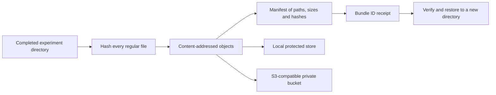

# Verified experiment artifact bundles

Database backups preserve application records. Training directories also contain model files, held-out predictions, feature records and configuration that must be preserved separately. The artifact CLI stores those files under their SHA-256 identities and publishes a deterministic manifest only after every referenced file has been stored.



## Local workflow

Stop writers to the experiment directory before publishing. From the repository root:

```sh
.venv/bin/python -m neurocore.artifacts --store data/artifact-store \
  publish artifacts/ideas-year1-reproduction
# Save the returned bundle_id in the study's operational records.
.venv/bin/python -m neurocore.artifacts --store data/artifact-store \
  verify BUNDLE_SHA256
.venv/bin/python -m neurocore.artifacts --store data/artifact-store \
  restore BUNDLE_SHA256 --destination data/recovery/restored-experiment
```

Identical filenames and bytes produce the same bundle ID. Repeated publication reuses verified objects; corrupted objects are rejected instead of overwritten. The receipt includes file count and byte count, without source filesystem paths. Store receipts alongside the run provenance and include both the store and receipts in offsite backups. A copy on the same disk is not disaster recovery.

The local store creates owner-only files and new root directories. Restores require a new destination and preserve relative filenames; existing destinations are never replaced. Symlinks, traversal paths, duplicate paths, file/directory conflicts, nonregular files and oversized files are rejected. A failed restore removes only its newly created output directory. Interrupted publication may leave unreferenced objects, but no completed manifest refers to partially written files. Garbage collection is not automatic.

Limits are 256 MiB per file and 10,000 files per bundle. This tool targets experiment artifacts, not bulk raw MRI archives. Do not write files while publishing: this is a verified file bundle, not a filesystem-wide point-in-time snapshot. Binary model files remain opaque bytes; publication, verification and restore never execute or deserialize them.

## S3-compatible storage

Install the optional SDK for a standalone core installation; the API container already includes it:

```sh
.venv/bin/pip install -c requirements.lock -e './packages/neurocore[storage]'
.venv/bin/python -m neurocore.artifacts --store s3://YOUR_PRIVATE_BUCKET/neuroresect \
  publish artifacts/ideas-year1-reproduction
```

Use the normal AWS credential/region configuration. `--endpoint-url` or `S3_ENDPOINT_URL` selects an S3-compatible endpoint. No bucket, ACL or public link is created. Uploading real experiment directories includes patient-level predictions/features and model binaries: configure access, encryption and retention for that research data before selecting a remote store.

The backend uses conditional `PutObject` requests with SHA-256 transfer checksums, then reads and verifies each object. Existing keys must have the expected bytes. The endpoint must support the [S3 conditional write API](https://docs.aws.amazon.com/boto3/latest/reference/services/s3/client/put_object.html); unsupported endpoints fail rather than falling back to overwriting objects. Conditional writes enforce immutability through this client, not against administrators or other bucket writers. Configure object lock/versioning and least-privilege policies separately where required.

Local and S3 backends share the manifest and bundle ID format. Tests run the complete publish/verify/restore path against an isolated Moto S3 emulator, including duplicate publication and corrupted objects. An actual cloud/MinIO deployment still needs its own credentials, policy and connectivity acceptance test; the test suite sends no research data to a cloud bucket.

## Relation to database and model recovery

Keep database backup receipts and artifact bundle receipts together, plus the exact source revision and dependency locks. Restore the database and artifacts independently and verify the recorded hashes before using a model. Current API results remain in relational storage; this phase adds explicit CLI artifact publication rather than an automatic model-serving registry. Registering a bundle does not validate clinical performance or enable real-patient predictions.

The real IDEAS baseline's six local artifacts were published and restored byte-for-byte during implementation. Their bundle ID is retained locally under `artifacts/ideas-year1-bundle-receipt.json`; patient-level bytes and local store objects are excluded from Git.
