# Local research backup and recovery

The SQLite recovery toolkit preserves application records: imported connectomes, scenarios, saved results, experiments, jobs and idempotency keys. It snapshots committed database state, verifies the snapshot and restores to a **new** file. This is the local SQLite part of the deployment programme; PostgreSQL/Redis recovery, authentication, schema migrations and external artifact storage remain separate work.

```mermaid
flowchart LR
    Live[(Live SQLite + WAL)] -->|SQLite online backup| Snapshot[Standalone snapshot]
    Snapshot --> Checks[Integrity + schema + inventory]
    Checks --> Bundle[Database + SHA-256 manifest]
    Bundle --> Verify[Verify and copy to staging]
    Verify --> Interrupted[Mark unfinished jobs failed]
    Interrupted --> New[(New SQLite path)]
    New --> Drill[Open API and inspect saved research]
```



## Create and verify a snapshot

From the repository root, with the API package installed:

```sh
.venv/bin/python -m neuroresect_api.backups backup \
  --database-url sqlite:///./data/neuroresect.db \
  --output data/backups/before-upgrade

.venv/bin/python -m neuroresect_api.backups verify data/backups/before-upgrade
```

`--database-url` defaults to `DATABASE_URL`, then the local SQLite URL. Each output directory must be new. The command uses [Python's SQLite online backup API](https://docs.python.org/3.14/library/sqlite3.html#sqlite3.Connection.backup), including committed WAL data while the application is running. It does not copy the live database file directly. A default 60-second snapshot deadline bounds waiting during sustained writes; use `--timeout` to change it. Pause submissions and wait for jobs to finish before taking a snapshot if completed results for those jobs are required.

A complete bundle contains `database.sqlite3` and `manifest.json`. The manifest records format/application version, timestamp, database size and SHA-256, schema fingerprint, table counts and job-status counts. It omits patient identifiers and the source database path. The database itself contains the full research records. New bundle directories use owner-only permissions, as do the snapshot and manifest files. Keep bundles under protected, ignored storage and copy them to your configured backup destination. Checksums detect accidental corruption; they do not authenticate an untrusted backup or provide encryption.

Verification checks the checksum, SQLite integrity, foreign keys, exact supported schema and inventories. Missing, incomplete or changed bundles fail. Backups with SQLite sidecar files are rejected; keep snapshots offline. Schema compatibility is checked against the installed API revision, so retain the matching source revision and dependency lockfiles with your operational release records.

## Restore and inspect before switching

```sh
.venv/bin/python -m neuroresect_api.backups restore \
  data/backups/before-upgrade \
  --destination data/recovery/research-restored.db

DATABASE_URL=sqlite:///./data/recovery/research-restored.db \
  .venv/bin/uvicorn neuroresect_api.main:app --host 127.0.0.1 --port 8001
```

The destination must not exist, including a symlink or leftover SQLite WAL/journal files. There is no overwrite option. Restore verifies the bundle, copies to a private staging file, verifies those copied bytes, checks the restored database and publishes it atomically without replacing existing files. The JSON receipt includes original/restored hashes, record counts and the number of interrupted jobs. The restored hash can differ because unfinished jobs are deliberately updated.

Check `http://localhost:8001/health` and the API docs at `/docs`. Compare the saved scenarios, simulation exports, experiments and imported connectomes with the expected study records. Stop this inspection instance before changing the production/local API's `DATABASE_URL` to the recovered path. Keep the original database and bundle until the recovery drill is accepted; switching the environment variable back retains a rollback path. The command never edits the original database or snapshot.

Jobs that were `QUEUED` or `RUNNING` at snapshot time become `FAILED` with stage `RESTORED_INTERRUPTED` and code `BACKUP_INTERRUPTED`. This applies to both executor labels. Completed/failed jobs and saved outputs remain unchanged. No work is automatically resubmitted, and no broker queue is restored. Resubmit needed work with a **new idempotency key**; replaying an old key still returns its preserved historical job.

## Coverage and limits

The automated recovery drill snapshots a live WAL database during an uncommitted write, verifies committed records, restores all five application tables, and opens the recovered API. It checks scenario results, experiment metrics, imports, completed jobs and interrupted local/Celery-labeled jobs. Failure cases include corrupted or incomplete bundles, changed manifests, schema drift, existing files/symlinks/sidecars, unsupported URLs, timeouts and missing source files.

The bundle does not contain downloaded IDEAS archives, local training artifacts, model binaries, filesystem assets, Redis queues, environment secrets or the source checkout. Back up those separately according to the deployment plan. This toolkit rejects PostgreSQL URLs; it is not a Compose disaster-recovery solution. Use deployment-specific PostgreSQL backup tooling and a separately tested broker/artifact recovery procedure before running a shared lab service. No retention scheduler or automatic offsite copy is configured.
