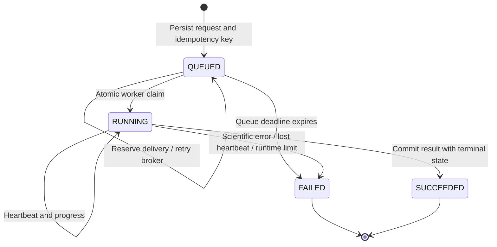

# Durable research job delivery and recovery

In Celery mode, the relational job record is the durable source of truth. The API's recovery loop republishes queued work after a broker outage, lost delivery or API restart. Database reservations serialize competing dispatchers; an atomic `QUEUED → RUNNING` transition admits only one computation for a job ID. Duplicate queue messages return without running the computation again.

## Failure behavior

| Trigger | Result |
| --- | --- |
| Broker unavailable during submission | HTTP 202 with persisted `QUEUED` job, stage `WAITING_FOR_BROKER`; delivery retries later |
| Publish succeeded but API stopped before reporting it | Job remains eligible for later redelivery; duplicate execution is prevented by the claim |
| API process restarts | Recovery scans persisted Celery jobs when the API returns |
| Multiple API processes scan the same job | One database delivery reservation wins during the retry window |
| Worker exits or loses database connectivity | Missed heartbeats eventually mark the job `FAILED`, code `WORKER_LEASE_EXPIRED` |
| Worker exceeds configured runtime despite heartbeats | Job fails through recovery; Celery also imposes the configured hard time limit |
| Old worker finishes after expiry | Guarded progress, intermediate results and completion cannot overwrite the failed job |
| No worker claims a queued job before its deadline | Job fails with `QUEUE_WAIT_EXPIRED` |

Failed computations are **not automatically retrained or rerun**. Submit a new job with a new idempotency key after investigating the failure. This preserves the failed attempt as an auditable record and avoids repeated execution of invalid scientific input. Completed results remain unchanged. A heartbeat failure does not immediately kill a Python computation; the terminal-state guards prevent subsequent publication, and the Celery hard runtime limit bounds its execution.

The recovery scan runs inside each API process in Celery mode. If every API instance is down, scanning resumes when one returns. If the database is down, neither durable submission nor recovery is available. PostgreSQL is the supported shared-worker database. Redis remains transport, not the research result store. Celery result-backend writes are disabled for these tasks because the API already persists results.

## Configuration

Use consistent values for API and workers:

| Environment variable | Default seconds | Purpose |
| --- | ---: | --- |
| `JOB_HEARTBEAT_SECONDS` | 15 | Worker liveness interval |
| `JOB_LEASE_SECONDS` | 90 | Allowed heartbeat silence |
| `JOB_MAX_RUNTIME_SECONDS` | 1200 | Maximum running duration and Celery hard limit |
| `JOB_QUEUE_TIMEOUT_SECONDS` | 3600 | Maximum wait for a worker claim |
| `JOB_DISPATCH_RETRY_SECONDS` | 30 | Minimum interval between delivery reservations |
| `JOB_RECOVERY_INTERVAL_SECONDS` | 10 | API recovery scan interval |

Heartbeat × 3 must not exceed the lease; the lease must not exceed runtime. Recovery decisions occur on a scan, so detection includes scan delay. Delivery attempts are exposed in job responses as `dispatch_attempts`; they count publish reservations, not repeated model fits. Scan batches are limited to 20 queued jobs. Tune queue/runtime limits to the approved workload before shared deployment.

The local thread executor retains its simpler policy: unfinished local jobs are marked interrupted after API restart, and local submission failures are terminal. It does not silently resume or claim Celery work. Backup restores mark unfinished jobs failed rather than replaying broker queues.

## Upgrade and validation

Revision `0002_job_recovery` adds liveness and delivery fields without replacing existing jobs. Follow the [migration procedure](DATABASE_MIGRATIONS.md) with API and workers stopped. Existing queued records receive zero dispatch attempts and become eligible for recovery; old running records without heartbeat timestamps are assessed using their saved timestamps.

Tests exercise broker failure/restart, idempotency, competing reservations/claims, heartbeat renewal, queue/runtime expiry, stale result suppression and recovery-loop shutdown. Container CI also runs `scripts/smoke_recovery.py`: it stops Redis and the worker, submits a job, restarts the API, restores services and verifies successful delivery using the original job ID. That script is destructive to the **disposable CI stack** and must not run against an active lab deployment.

See the [Celery task documentation](https://docs.celeryq.dev/en/stable/userguide/tasks.html) for why transport acknowledgements alone do not guarantee single execution or recovery after worker termination. The database state machine supplies the application's execution and publication guards.
